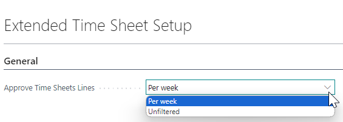
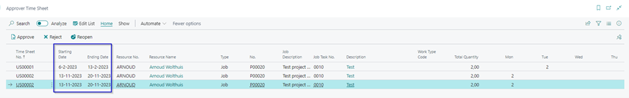

# Manual Extended Time Sheets
Do you want the user responsible for a project to approve the resource hours written on the project, with this extension you can set a time sheet approver on a project. 

## Approve Time Sheets

### Time Sheet Line To Approve
The time sheet lines to approve can be found under Self-Service, section Approvals on the tile **Time Sheet Lines To Approve**. To approve the time sheet lines select the tile **Time Sheet Line to Approve**. This tile is only visible for the Time Sheet Approver.

The page with the time sheet lines to approve will open. 

When selecting the tile to approve the time sheet lines the default page is shown with a starting date of the first Week day of the current week. This is based on the setting in the resource setup. 
Under Home in the menu you find the actions **Approve**, **Reject** and **Reopen** and also the actions **Previous Period** or **Next period** to switch between weeks if necessary.

### Processing Time Sheet Lines to be approved
The Approver Time Sheet Page shows the hours linked to the relevant approver. Under the **Home** button in the menu there are three option, **Approve**, **Reject** and **Reopen**. Processing works equal to standard Business Central.

*	**Approve** -> the option to approve the **Selected line(s)** only or **All Submitted line(s)** -> The Status of the Time Sheet Line(s) changes to **Approved**.
*	**Reject** -> the option to reject the **Selected line(s)** only or **All Submitted line(s)** -> The Status of the Time Sheet Line(s) changes to **Rejected**. The user can see on the Role Center on the tile **Rejected Time Sheets** under Self-Service the number of rejected time sheet lines.
*	**Reopen** -> the option to reopen the **Selected line(s)** only or **All Approved  line(s)** -> The Status of the Time Sheet Line(s) changes to **Submitted**. This action is used when a time sheet line is already approved and not posted yet. After the approver has reopened the time sheet line and the status is changed to Submitted then the user can reopen the time sheet line and make the adjustments.

[:arrow_left:](../README.md) [Back](../README.md)