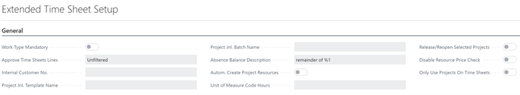
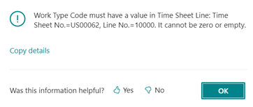
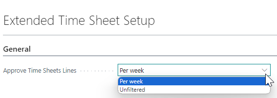
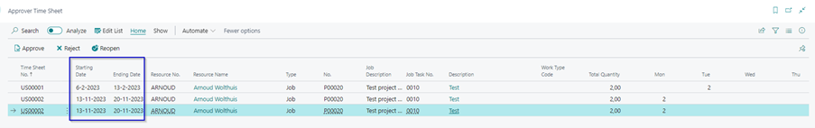
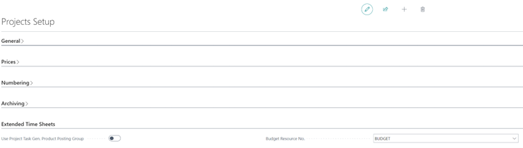

# Manual Extended Time Sheets
Do you want the user responsible for a project to approve the resource hours written on the project, with this extension you can set a time sheet approver on a project. 

## Extended Time Sheet Setup

### Extended Time Sheet Setup
In the Extended Time Sheet Setup page default setting can be set for the way you want to work with the solution. 

#### Work Type Mandatory ####
This option makes the use of a Work Type mandatory when using Time Sheets.
In the Time Sheet an error message will appear when submitting line(s) with No Work Type Code included.

#### Approval Time Sheet Lines ####
There is an option to show all lines to be approved in a list instead of an overview of lines per week as described in the previous paragraph.
You can use this option if for example you don’t want to approve the time sheet lines per week but per month. 
This option is set on the **Extended Time Sheet Setup** page. In the field Approve Time Sheets Lines you have the choice of **Per Week** or **Unfiltered**.

When using the Unfiltered setting then you will use the Extended Time Sheet Page to approve the time sheet lines, were you see all the time sheet lines to be approved in a list page. Where the Starting- and Ending Date corresponds to the week date of the Time Sheet.

Changing the Approve Time Sheets Lines field to Unfiltered will also change the behavior of the Tile the **Time Sheet Lines to Approve** under **Approvals** on the Role Center.

#### Internal Customer No. ####
When a customer number is filled in this field then it is possible to change the approver on the Time Sheet Line of the Project to the approver that is setup on the resource. This will be the manager of the resource and not the project manager (approver) on Project level.
This can be the case for projects that are used for handling absence. If the Internal Customer No. is used on the Project and the **Time Sheet Approver User ID** is not filled then the approver of the Time Sheet Line will be the Approver ID filled from the specific resource.

#### Project Journal Template Name ####
This field specifies the **Journal Template Name** which is used in the Project Journal to suggest and post the Project Time Sheet Lines.

#### Project Journal Batch Name ####
This field specifies the **Journal Batch Name** which is used in the Project Journal to suggest and post the Project Time Sheet Lines in.

#### Absence Balance Description ####
This field specifies the description to have influence on the description field used in the creation of the project planning line, when transferring the remaining absence balance to the new ‘Absence’ Project. This transfer can be done on the [Absence Project](projects.md#absences-project) page.  

#### Automatically Create Project Resources ####
This field specifies whether project resources are automatically created based on project planning lines.

#### Unit of Measure Code Hours ####
This field specifies the unit of measure code used for the Hour calculation the Project Task Sub form Lines. The columns with “Total Hours” included in the description.

#### Release/Reopen Selected Projects ####
Specifies whether it is possible to release or reopen multiple projects for time sheets based on the selected projects.

#### Disable Resource Price Check ####
Specifies whether the check on resource price is disabled during releasing the project for time sheets.

#### Only Use Projects On Time Sheets ####
Specifies whether to only use projects on time sheets. This will disable the type field on the Time Sheet Line.

#### Project Setup ####
On the Project Setup page Extended Time Sheets settings are added.

#### Budget Resource No. ####
On the Projects Setup page you can set in the **Budget Resource No.** field a resource which is used for budgeting purposes only. This resource is used if you don’t want to budget on a specific resource but more in general. Project Planning Lines for this resource will be removed during releasing for Time Sheets.

#### Use Project Task Gen. Product Posting Group.####
With this option you can specifies if the **Gen. Product Posting Group** from the project task is used with the postings. 
When the setting is disabled, the field is not visible on the Project page.

[:arrow_left:](../README.md) [Back](../README.md)