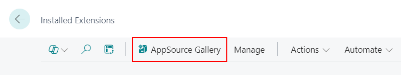
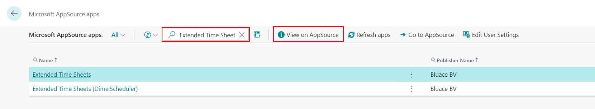
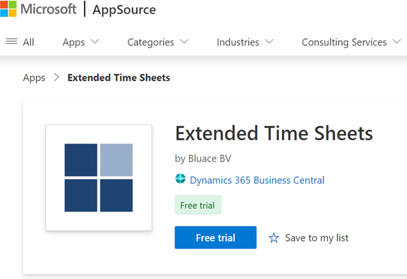

# Manual Extended Time Sheets
Do you want the user responsible for a project to approve the resource hours written on the project, with this extension you can set a time sheet approver on a project. 

## Install and activate the app
The following procedure shows how an administrator can install the extension through the Extension Management page.
1.	Choose the Search icon, Enter Extension Management, and the choose the related link. 
2.	Choose AppSource Gallery from the menu.

    

3.	In the AppSource Gallery search for **Extended Time Sheets**.

    

4.	Select the **Extended Time Sheets** app. 
5.	Choose from the menu the **View on AppSource** action. 

    

6.	Click on Free Trial. This will open Business Central. When multiple environments exist, the system will ask you in which environment the app must be installed.
7.	After installation, go to Bluace Products and activate Base Functionality and Extended Time Sheets.
8.	Permission sets have automatically been installed for the apps License Permission, Base Functionality and Extended Time Sheets. Every user needs to have Licensing User LBLC assigned. The permission sets Base Funct. BBLC and Ext Time Sheets XBLC contain all permissions for the installed apps. More fine-grained permission sets can be created based on those.

[:arrow_left:](../README.md) [Back](../README.md)