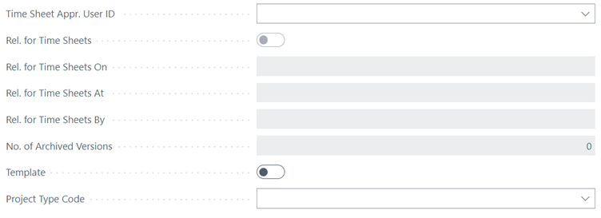
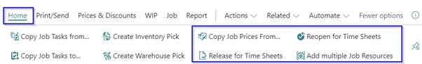
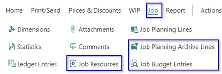
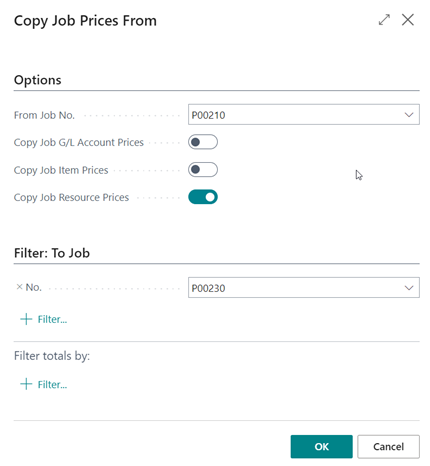

# Manual Extended Time Sheets
Do you want the user responsible for a project to approve the resource hours written on the project, with this extension you can set a time sheet approver on a project. 

## Projects

### Additional fields on the project card

In the Extended Time Sheet solution there are a number of fields which are added to the Project card.

Project Header – General fast tab:
*	Time Sheet Appr. User ID -> the user-id who will approve the time sheet lines
*	Rel. for Time Sheets Boolean -> as an information field
*	Rel. for Time Sheets On -> is release date
*	Rel. for Time Sheets At -> is release time
*	Rel. for Time Sheets By -> user id who executed the action
*	Project Type Code -> specifies a Project Type for internal use, reporting, selection purpose.

Project Line – Tasks:
*	Gen. Prod. Posting Group -> this field specifies the General Product Posting Group which is used when posting to this project task.
*	Deferral Code -> this field specifies the deferral code used in the Sales Invoice Line that is created from the related project planning line.

Actions in menu:
*	Under Home
    *	Copy Project Prices From..
    *	Release for Time Sheets
    *	Reopen for Time Sheets
    *	Add multiple Project Resources

*	Under Project
    *	Project Resources
    *	Project Planning Archive Lines
    *	Project Budget entries

*	Under Report
    *	Customer Time Sheet

### Copy Project Prices From..
With this function you are able to copy Project Prices one Project to another one. Where you can select from/to which project and which type of price you want to copy. G/L account, item or resource.

### Release / Reopen for Time Sheets
With this function you release the project for Time Sheets which means that the project can be used for resources to write time on.
With this action also the project planning lines are copied to the Project Budget Entries table. This will be done only at the **first** release for Time Sheet.
With the **Reopen** action you remove the Release for Time Sheets and the job is not visible for the resource in there Time Sheet.

### Add multiple Project Resources
With this action you can select multiple project resources to be able to write time on the specific project.

### Project budget entries
With the solution it is possible to register an initial budget which is saved in a separate table.
At the first time the Release for Time Sheet action is done all the project planning lines at that moment are copied to the Project Budget Entries table.

There is an additional function on the Project planning lines to be able to make changes to the budget after the Release for Time Sheet is done. With the action **Add Selection To Project Budget Entries** it is possible to make adjustments in the Budget Entries Table. 

### Absences Project
When using a project to register ‘budget’ and collect the actual holiday/ leave hours it is possible to transfer the remaining hours to a new project e.g. if you register the hours per year and have therefore every year a new project. 
The description used in the transfer is from the field Absence Balance Description filled in the Extended Time Sheet Setup page.

> [!IMPORTANT]
>* The Project must contain exactly the same Project Tasks as far as there are budget entries on the Project Task. When that is not the case, an error is shown.
>* All blocked resources must have a zero remaining balance on the project before you transfer the remaining balance. An error will appear when a blocked resource has a remaining balance to be transferred.

[:arrow_left:](../README.md) [Back](../README.md)