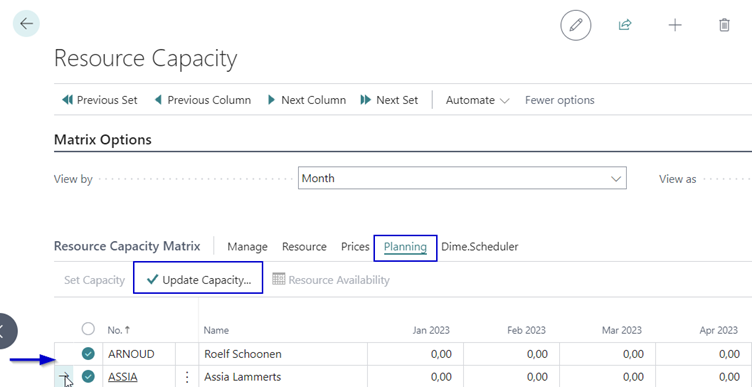
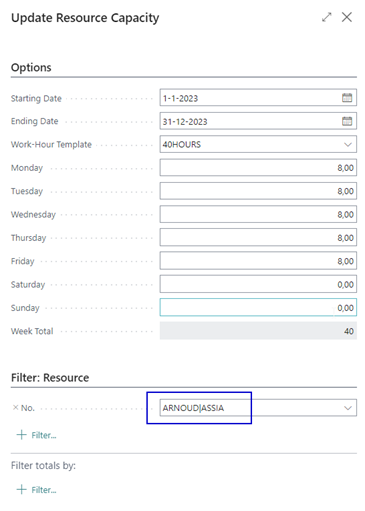
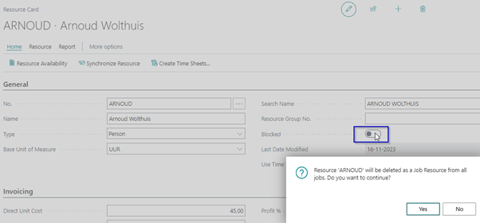

# Manual Extended Time Sheets
Do you want the user responsible for a project to approve the resource hours written on the project, with this extension you can set a time sheet approver on a project. 

## Resources

### Resource capacity update
In the Extended Time Sheet solutions an additional action is added that makes it possible to update the resource capacity for a selection of resources or based on a given filter. This action is added under the **Planning** menu in the Resource Capacity Matrix section.

1.	Choose the search icon, enter **Resource Capacity** and choose the related link.
2.	Select the required resources to update
3.	Select the **Update Capacity…** action
4.	Fill the **Starting**- and **Ending Date**.
5.	Select/ create the related **Work-Hour Template**

In the Filter: Resource section you will find the selected resources pre-filled.

The Update Resource Capacity can also be run based on other filters, for example leave the **No.** field blank (all resources) and add a filter on Blocked and set it to **No**.

### Off boarding - set a resource to blocked
When a resource is leaves the company you want to ensure that the resource cannot be selected anymore as a Project resource on a Project.
When a resource is set to **Blocked** the question to remove the Project Resources from all the projects (project resources) will appear. By selecting yes the Resource will be deleted as a Project Resource from all the projects.

[:arrow_left:](../README.md) [Back](../README.md)