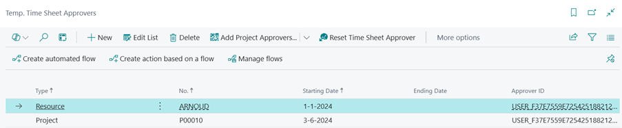
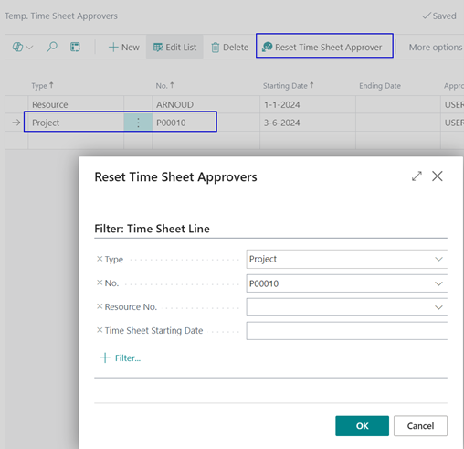
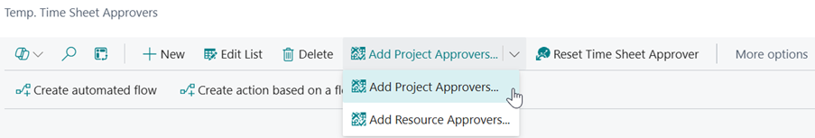
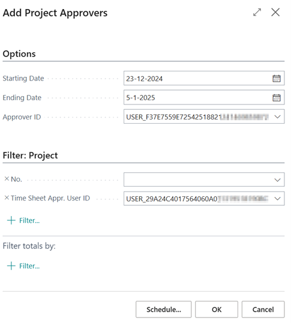

# Manual Extended Time Sheets
Do you want the user responsible for a project to approve the resource hours written on the project, with this extension you can set a time sheet approver on a project. 

## Setup a Temporary Time Sheet Approver
In the Extended Time Sheet solution an option is included to temporarily adjust the project approver on the timesheets. You can use this option, for example, if the approver is going on holiday to temporarily link another approver to his timesheets.

Via the action Temp. Time Sheet Approvers you can specify a temporary approver for a project or a resource by means of a Start- and End Date.

> [!IMPORTANT]
The Starting Date must be equal to the first week day setting in the Resource Setup. Usually this is Monday.
The Ending Date is always a date that corresponds to the last day of the timesheet setting in the Resource Setup. Usually this is Sunday.

1.	In the field Type select e.g. **Project**, or **Resource** the choice depends on how time registration is set up for the company. Usually through **projects**.
2.	Select in the **No** field, the desired project
3.	Enter in the **Starting Date** field, the desired date.
4.	Enter In the **Ending Date** field, the desired date.
5.	And finally, in the **Approver ID** field, select the desired approver.

### Reset Time Sheet Approver
With the action **Reset Time Sheet Approver** you are able to reset the approver on the Time Sheet Lines for a specific project to the Approver ID setup on the Temp. Time Sheet Approvers page. 
Or if you needed to reset it back to the Original Time Sheet Approver.

### Add Approvers (project or resource)
With the action **Add Project Approvers** you are able to insert a range of projects were you want to set a temporary approver.

1.	Enter in the **Starting Date** field, the desired date.
2.	Enter In the **Ending Date** field, the desired date.
3.	Enter in the **Approver ID** field, the temporary Approver User ID.
4.	Enter in the **Time Sheet Appr. User ID** field, the Project Approver that will be temporary replaced as approver.

[:arrow_left:](../README.md) [Back](../README.md)